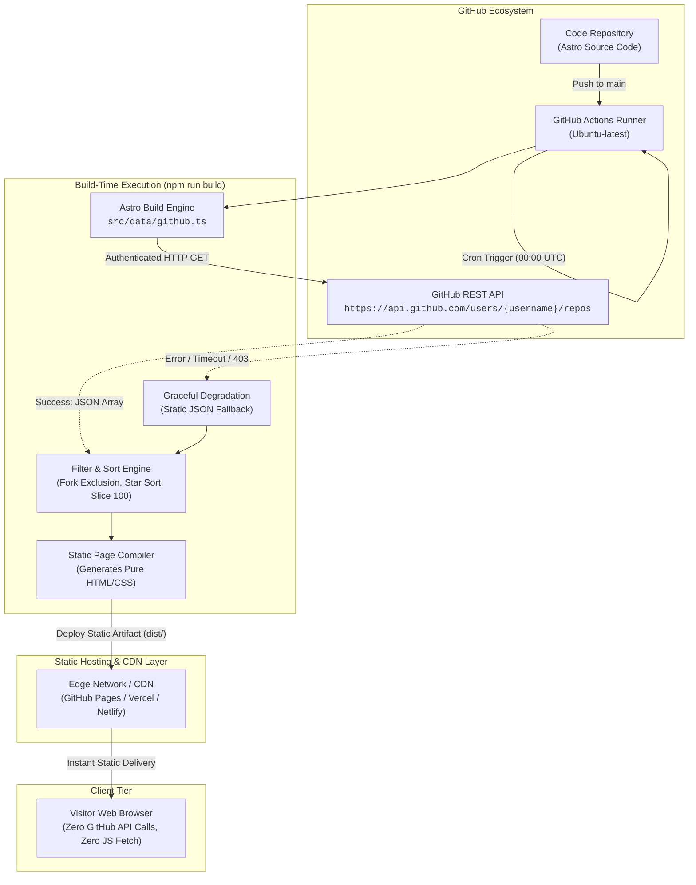
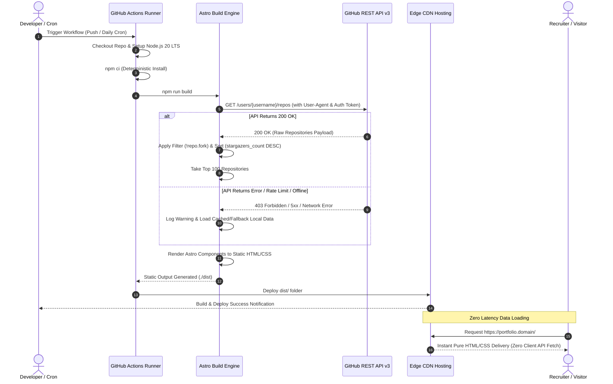
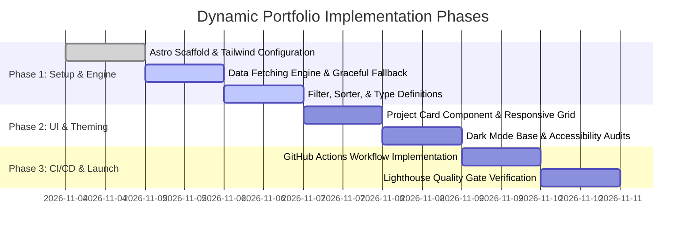

# Product Requirement Document (PRD)
## Dynamic Developer Portfolio (Jamstack & SSG Architecture)

---

### Document Control & Metadata
* **Document Version:** 1.0.0
* **Project Name:** Dynamic Developer Portfolio
* **Status:** Approved / Ready for Implementation
* **Role / Author:** Senior Product Manager & Principal Software Architect
* **Target Stack:** Astro Framework, TypeScript, Tailwind CSS, GitHub REST API, GitHub Actions CI/CD
* **Phase:** Pre-Docker / Phase 1 (Static Site Generation & Build Automation)

---

## 1. Product Overview & Strategic Objectives

### 1.1 Executive Summary
**Dynamic Developer Portfolio** adalah solusi portfolio digital berkinerja tinggi yang dirancang untuk mengatasi masalah *portfolio rot* (kondisi di mana situs portfolio pengembang menjadi usang karena keengganan atau kelupaan memperbarui kode secara manual). Sistem ini mengadopsi metodologi Jamstack murni dengan Static Site Generation (SSG) via Astro, mengintegrasikan data repositori GitHub secara otomatis pada saat kompilasi (*build-time*).

### 1.2 Core Value Proposition
* **Automated Sync:** Repositori publik baru, bintang (*stars*), dan deskripsi proyek langsung tersinkronisasi tanpa perubahan kode manual.
* **Peak Performance:** Pengiriman 100% HTML statis tanpa overhead framework JavaScript di browser (*Zero Client-side JS overhead*).
* **Zero Rate-Limit Risk:** Seluruh beban pemanggilan GitHub API diisolasi ke server CI/CD (*build runner*), melindungi pengunjung dari limitasi rate limit API publik.

### 1.3 Key Performance Indicators (KPIs) & Success Metrics
| Metric | Target | Rationale & Measurement Method |
| :--- | :--- | :--- |
| **Google Lighthouse Performance** | **>= 98** | Diukur pada koneksi simulasi Mobile 4G & Desktop audit. |
| **Google Lighthouse SEO & Best Practices**| **>= 95** | Struktur meta tag, semantic HTML, dan robots/sitemap terintegrasi. |
| **First Contentful Paint (FCP)** | **< 0.8 s** | Menjamin persepsi respon instan saat pengunjung membuka web. |
| **Cumulative Layout Shift (CLS)** | **0.00** | Tidak ada pergeseran tata letak dinamis pasca pemuatan halaman. |
| **API Availability Resilience** | **100% uptime** | Kegagalan GitHub API saat build tidak menyebabkan *broken deployment*. |
| **Maintenance Overhead** | **0 jam/bulan** | Sinkronisasi berjalan mandiri via scheduled workflow. |

---

## 2. User Stories & Persona Profiles

### 2.1 Persona Definitions
1. **Developer (Product Owner - "Alex"):**
   * *Background:* Software engineer aktif yang rutin mempublikasikan repositori *open source* namun tidak memiliki waktu mengedit file HTML/JSON setiap kali membuat proyek baru.
   * *Frustration:* Portfolio sering tertinggal 6-12 bulan dari aktivitas nyata di GitHub.
2. **Tech Recruiter / Client ("Sarah"):**
   * *Background:* Technical Talent Sourcer atau Engineering Director yang mengevaluasi portofolio calon kandidat dalam waktu singkat (< 30 detik).
   * *Frustration:* Situs portofolio yang lambat dibuka, bergantung pada spinner loading API client, dan berisi tautan repositori yang sudah usang atau mati.

### 2.2 Detailed User Stories & Acceptance Criteria

#### US-1: Automated Project Ingestion
* **As a** Developer (Owner),
* **I want** portofolio saya otomatis menarik proyek publik terbaru saya dari GitHub saat jadwal harian atau saat commit baru,
* **So that** saya tidak perlu melakukan koding ulang atau memperbarui konten secara manual.

> **Acceptance Criteria (Gherkin):**
> * **Given** saya membuat repositori publik baru di akun GitHub saya,
> * **When** pipeline GitHub Actions berjalan pada jadwal cron harian (00:00 UTC),
> * **Then** proyek baru tersebut otomatis terkompilasi ke dalam HTML statis dan tampil di portofolio dengan deskripsi serta metrik yang sesuai.

#### US-2: Fast & Reliable Evaluation Experience
* **As a** Tech Recruiter / Client,
* **I want** halaman web langsung terbuka seketika tanpa loading spinner dan menampilkan metrik popularitas proyek (stars, forks) serta bahasa utama,
* **So that** saya dapat dengan cepat menilai kompetensi teknis dan spesialisasi pemilik portofolio.

> **Acceptance Criteria (Gherkin):**
> * **Given** koneksi internet standar pada perangkat mobile,
> * **When** pengunjung membuka alamat situs portofolio,
> * **Then** seluruh kartu proyek langsung ter-render tanpa delay network request ke GitHub dari sisi browser, dengan link valid yang mengarah ke repositori terkait.

---

## 3. System Architecture & Data Flow (Pre-Docker Phase)

### 3.1 High-Level Architecture Diagram
Arsitektur Jamstack memisahkan *data processing layer* dari *content consumption layer*:



### 3.2 Sequence Execution Diagram (Build Automation Lifecycle)



---

## 4. Functional Requirements (FR)

### FR-1: Data Fetching Engine (Build-Time Execution)
* **FR-1.1 API Endpoint Specification:**
  * Target Endpoint: `https://api.github.com/users/{username}/repos`
  * Query Parameters: `?per_page=100&sort=updated`
  * Request Headers:
    * `Accept: application/vnd.github.v3+json`
    * `User-Agent: Dynamic-Portfolio-Astro-Engine`
    * `Authorization: Bearer ${{ secrets.GITHUB_TOKEN }}` (Menggunakan token built-in GitHub Actions untuk menaikkan rate limit dari 60 menjadi 1.000 req/jam).
* **FR-1.2 Resiliency & Graceful Degradation:**
  * Pemanggilan API dibungkus dalam blok `try...catch` dengan batas waktu timeout jaringan (Network timeout: 8000ms).
  * Jika API mengembalikan status non-200 (misalnya `403 Rate Limited`, `500 Server Error`, atau `FetchError`), sistem **dilarang melakukan crash/fatal throw** pada proses build.
  * *Fallback Strategy:* Sistem membaca dataset cadangan lokal (`src/data/fallback-repos.json`). Jika file fallback belum ada, sistem mengembalikan *empty state graceful warning* yang tetap berhasil dikompilasi menjadi halaman HTML statis yang rapi.

### FR-2: Data Filtering, Transformation & Sorting Logic
Data mentah dari GitHub API wajib melewati fungsi pipeline transformasi murni (*deterministic pipeline*):

```typescript
// Architectural Data Transformation Pipeline Specification
export interface GitHubRawRepo {
  id: number;
  name: string;
  full_name: string;
  description: string | null;
  html_url: string;
  fork: boolean;
  stargazers_count: number;
  forks_count: number;
  language: string | null;
  updated_at: string;
  topics?: string[];
}

export interface PortfolioProject {
  id: number;
  name: string;
  description: string;
  url: string;
  stars: number;
  forks: number;
  primaryLanguage: string;
  formattedDate: string;
}
```

* **FR-2.1 Filtering Logic:**
  * Mengeliminasi repositori hasil fork milik orang lain: `!repo.fork`.
  * *(Opsional/Configurable)* Mengeliminasi repositori yang diarsipkan (`!repo.archived`) jika flag diaktifkan di konfigurasi.
* **FR-2.2 Sorting Logic:**
  * Diurutkan secara menurun (*descending*) berdasarkan jumlah bintang:
    `Primary Sort: repoB.stargazers_count - repoA.stargazers_count`
  * *Tie-breaker rule:* Jika jumlah bintang sama, urutkan berdasarkan waktu pembaruan terbaru (`new Date(repoB.updated_at).getTime() - new Date(repoA.updated_at).getTime()`).
* **FR-2.3 Slicing & Boundary:**
  * Mengambil maksimal 100 entitas repositori pertama: `.slice(0, 100)`.

### FR-3: Dynamic UI Components & Presentation Specification
* **FR-3.1 Projects Metrics Header:**
  * Menampilkan badge indikator counter dinamis:
    `"Showing " + projects.length + " active open-source projects"`
* **FR-3.2 Project Card UI Matrix:**
  Setiap kartu repositori dirender secara semantik (`<article class="project-card">`) dengan atribut data berikut:
  1. **Project Title:** `name` (Typography: Semi-bold, High-contrast).
  2. **Description Text:** `description` (Jika null/kosong, gunakan fallback: *"No description provided for this repository."*).
  3. **Primary Language Tag:** `primaryLanguage` (Jika null, fallback ke *"Plain Text"* atau *"Markdown"*, dilengkapi dot warna aksen).
  4. **Engagement Stats:**
     * Icon Bintang + `stars` count.
     * Icon Fork + `forks` count.
  5. **External Action Link:** Direct URL ke `html_url` dengan atribut keamanan wajib:
     `target="_blank" rel="noopener noreferrer" aria-label="Visit repository {name}"`.

---

## 5. Non-Functional Requirements (NFR)

### NFR-1: Performance & Zero-JS Architecture
* **Jamstack SSG Constraint:** Seluruh halaman harus dikompilasi menjadi static HTML murni pada direktori `./dist`.
* **Zero Client-Side Fetch:** Browser dilarang memuat skrip runtime (`fetch()` atau SDK GitHub) untuk mengambil data proyek.
* **Aset Bundling:** CSS wajib diminifikasi otomatis saat build, font menggunakan *subset modern* (`woff2`) dengan strategi `font-display: swap`.

### NFR-2: Rate Limit & Security Boundary
* **Rate-Limit Isolation:** GitHub API hanya diakses oleh server build runner (1 kali request per build). Dengan frekuensi 1 kali/hari via cron + manual push, total penggunaan kuota API adalah sekitar 30 - 60 requests/bulan (sangat jauh di bawah limit 1.000 - 5.000 req/jam).
* **Token Hardening:** GitHub Personal Access Token (jika digunakan) tidak boleh diekspos ke file HTML statis hasil kompilasi. Astro membatasi variabel environment server-side agar tidak masuk ke client bundle.

### NFR-3: Visual Design & Responsive Accessibility
* **Layout Grid:** CSS Grid responsif (1 kolom pada layar mobile `< 640px`, 2 kolom pada tablet `640px - 1024px`, 3 kolom pada desktop `> 1024px`).
* **Theming:** Dark Mode First (Base palette: slate/zinc dark theme, rasio kontras teks minimum 4.5:1 sesuai standar WCAG 2.1 AA).
* **Accessibility (a11y):** Navigasi keyboard penuh (`tabindex`, focus outline visible), ikon menggunakan representasi visual + accessible screen reader text.

---

## 6. Automation & CI/CD Pipeline (GitHub Actions Specification)

### 6.1 Trigger Matrix
1. **Event-driven:** `push` ke branch `main`.
2. **Time-driven (Scheduled):** Cron Expression `0 0 * * *` (Setiap hari pukul 00:00 UTC).
3. **Manual Trigger:** `workflow_dispatch` (Memungkinkan eksekusi sinkronisasi langsung dari web UI GitHub Actions).

### 6.2 Reference Workflow Configuration (`.github/workflows/deploy.yml`)

```yaml
name: Deploy Dynamic Portfolio SSG

on:
  push:
    branches:
      - main
  schedule:
    - cron: '0 0 * * *' # Trigger setiap 24 jam sekali
  workflow_dispatch:      # Trigger manual on-demand

permissions:
  contents: read
  pages: write
  id-token: write

concurrency:
  group: 'pages'
  cancel-in-progress: false

jobs:
  build:
    name: Build Static Artifacts
    runs-on: ubuntu-latest
    steps:
      - name: Checkout Source Code
        uses: actions/checkout@v4

      - name: Setup Node.js Environment
        uses: actions/setup-node@v4
        with:
          node-version: 20
          cache: 'npm'

      - name: Install Dependencies
        run: npm ci

      - name: Build Astro SSG
        env:
          GITHUB_TOKEN: ${{ secrets.GITHUB_TOKEN }}
          GITHUB_USERNAME: ${{ vars.PUBLIC_GITHUB_USERNAME || github.repository_owner }}
        run: npm run build

      - name: Upload Static Pages Artifact
        uses: actions/upload-pages-artifact@v3
        with:
          path: './dist'

  deploy:
    name: Deploy to GitHub Pages Edge
    needs: build
    runs-on: ubuntu-latest
    environment:
      name: github-pages
      url: ${{ steps.deployment.outputs.page_url }}
    steps:
      - name: Deploy to GitHub Pages
        id: deployment
        uses: actions/deploy-pages@v4
```

---

## 7. Scope Boundaries (In-Scope vs. Out-of-Scope)

```
+------------------------------------+-------------------------------------+
|        IN SCOPE (Phase 1)          |      OUT OF SCOPE (Deferred)        |
+------------------------------------+-------------------------------------+
| [x] Astro SSG Framework Setup      | [ ] Dockerfile / Docker Compose     |
| [x] GitHub REST API Integration    | [ ] Container Registry (GHCR/Docker)|
| [x] Data Sorting & Filtering Engine| [ ] GitHub OAuth User Login         |
| [x] Fallback Data Degradation      | [ ] Private Repositories Ingestion  |
| [x] GitHub Actions CI/CD Pipeline  | [ ] Real-time Webhook Receiver      |
| [x] Responsive CSS Grid UI Cards   | [ ] Dynamic Server-Side Rendering   |
| [x] Lighthouse Score > 95 Opt.     | [ ] Database / Persistence Layer    |
+------------------------------------+-------------------------------------+
```

### Detailed Justification for Out-of-Scope Items
* **Docker / Containerization:** Proyek pada fase ini menargetkan platform hosting statis murni (GitHub Pages/Vercel/Netlify) yang membutuhkan artefak HTML/CSS/JS siap saji. Containerization ditunda ke fase selanjutnya saat ada kebutuhan migrasi ke VPS mandiri atau arsitektur microservices.
* **Private Repositories:** Memerlukan token khusus dengan scope `repo` privat yang memiliki risiko keamanan lebih tinggi jika tidak dikelola dengan secret rotation ketat.
* **Webhooks:** Membutuhkan server endpoint aktif 24/7 untuk menerima event push real-time dari GitHub. Polling via cron 24 jam sudah memenuhi kebutuhan bisnis portfolio tanpa biaya server.

---

## 8. Implementation Roadmap & Verification Gate



### Phase 1 Acceptance Gate Checklist
* [ ] Pipeline build berhasil tanpa runtime error (`npm run build`).
* [ ] File `dist/index.html` terbuat dan berisi elemen daftar proyek yang berasal dari GitHub API.
* [ ] Uji coba skenario offline: Matikan koneksi / buat API mock error -> Build tetap selesai menggunakan fallback mock data.
* [ ] Skor Google Lighthouse Performance >= 98 dan CLS = 0.
* [ ] Workflow GitHub Actions berhasil dideploy ke GitHub Pages atau Vercel.

